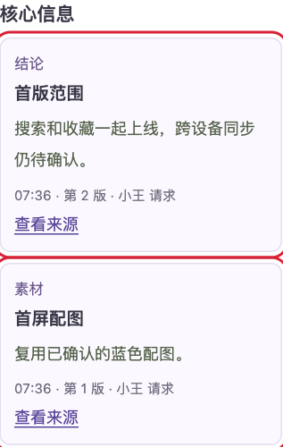
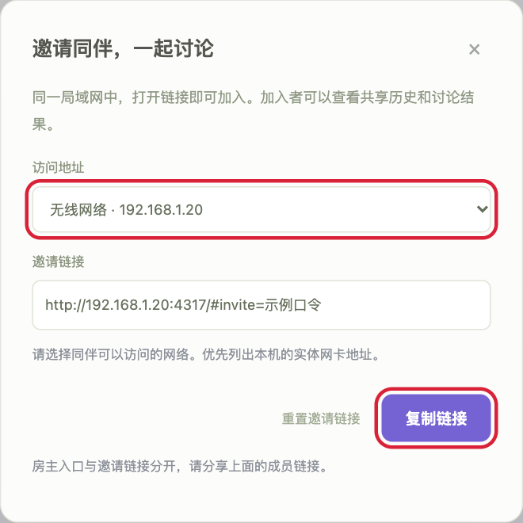
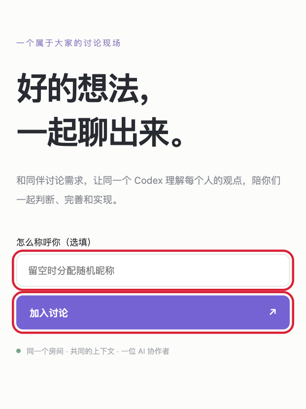
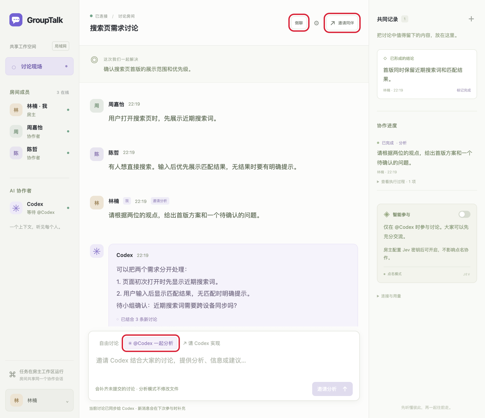
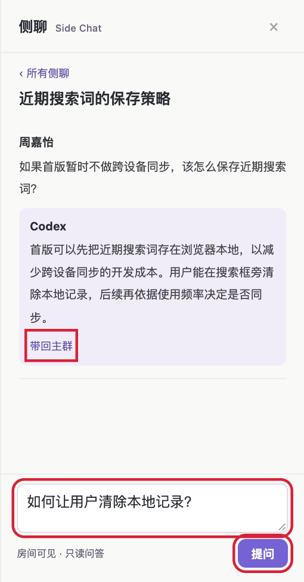
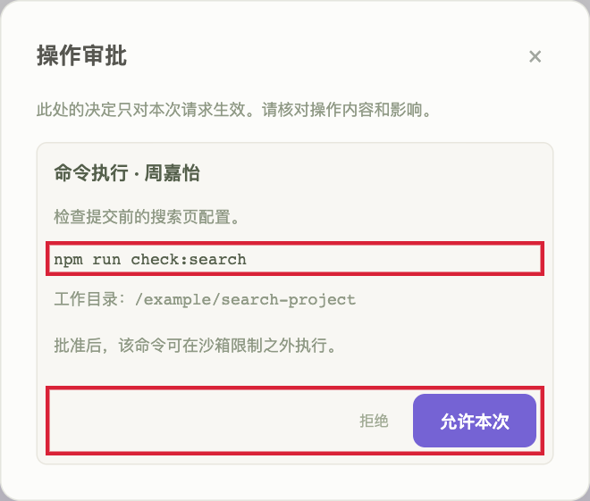

# GroupTalk

局域网里的多人协作讨论室。多个真人先讨论同一个需求或方案，再邀请同一个 Codex 提供信息、比较取舍、澄清问题或执行任务。所有人共享讨论、上下文和结果。

## 从安装到加入群聊

### 1. 安装 Skill

房主在已登录的本地 Codex 中发送这条安装指令。

```text
$skill-installer 安装 https://github.com/cheatcodezky/group-talk/tree/main/skills/grouptalk
```

已经安装过的房主可以先停止房间，请 Codex 把旧版 Skill 目录移到备份位置，再用同一条指令安装最新版。从原来的来源对话开房即可恢复房间和记录。

### 2. 从想分享的对话开房

安装完成后，打开想分享的本地 Codex 对话，发送下面这条消息。首次缺少可用的 Node.js 时，Skill 会联网安装运行时，随后继续启动。

```text
$grouptalk 把当前对话开成局域网群聊。
```

看到 `GroupTalk 已启动` 后，在开房的电脑上打开 **房主入口** 并加入。房主昵称可以留空，默认叫「房主」。从已有对话开房时，加入者会先看到 **来源对话**，其中包含开房前的消息和 Codex 回复。点 **群聊** 可以切换到大家的新讨论。

共享的 Codex 回复中，链接的工作区 HTML 和 Markdown 可在浏览器内打开。工作区图片和共享会话的 Codex 生成图片会显示缩略图，点击即可在浮窗放大。HTML 预览在隔离页面中运行，支持文件内嵌的脚本、样式和媒体。支持的文件可下载，房主选择分享的来源对话和工作区决定成员可以看到的内容。

右侧的「房间速览」会根据共享回复与共同记录提取目标、进展、实测和待确认项，并汇总可打开的产物。点击顶部「成员」和「房间速览」可分别收起或打开两侧面板。手机上两侧面板以抽屉打开。速览随房间更新，无需模型调用。

### 让 AI 发布核心信息

在群聊里发送 `@Codex 请把当前的核心结论、待确认项和关键素材更新到右侧核心信息，保留已有分歧。`。AI 的这次回复会附带结构化更新，服务端校验后发布到「房间速览」顶部，所有成员同步看到。每项保留版本、请求者和来源回复。

每个条目有稳定的 `id`。例如范围用 `scope`，配图用 `hero-image`。更新时只替换同一 id 的内容，这次没提到的条目继续保留。可以接着说 `@Codex 更新 scope 的范围，保留 hero-image，删除已过期的 deadline。`



AI 使用下面的输出格式。它是供网页解析的 JSON 代码块，正常回复仍在群聊中保留。这里只作协议示例。

````text
```grouptalk-core
{"version":1,"upsert":[{"id":"scope","kind":"conclusion","title":"首版范围","content":"首版先完成搜索，跨设备同步继续待确认。"}],"remove":[]}
```
````

`kind` 支持 `conclusion`、`proposal`、`question`、`action`、`progress` 和 `artifact`，分别表示结论、建议、问题、行动项、进展和素材说明。每批最多变动 20 项，最多保留 40 项。格式错误的整批更新会被拒绝，具体原因在对应任务的执行过程显示。核心信息作为后续 AI 回合的背景资料，执行任务仍遵循房主审批。

### 3. 复制邀请链接，让成员加入

房主在网页右上角点击 **邀请同伴**。在 **访问地址** 里选择同伴能访问的局域网地址，点 **复制链接**，把成员链接发给同一网络上的同伴。下图的链接为示例。



同伴用浏览器打开成员链接，点 **加入讨论**。昵称可以留空，房间会分配一个随机昵称。



房主可在成员列表查看本次连接的 IP 和可识别的 MAC。MAC 取自本机的 IPv4 邻居记录，查不到时显示「未识别」。地址信息限本机房主查看，保存在服务进程内存中。

保持开房电脑和启动终端运行。结束时，房主可以在网页顶部点 **停止服务 → 确认停止**，也可以在启动终端按 Ctrl+C。再次从同一个来源对话启动，会恢复原房间、邀请口令和协作分支。默认数据位置是 `~/.grouptalk/rooms/`，开房端口由系统分配。

## 配置 Skill 和恢复启动

房主使用已登录的本地 Codex。Skill 优先使用 `PATH` 中支持 SQLite 的 Node.js 22.13 或更高版本。如果缺少 Node.js、版本过旧或 SQLite 不可用，启动脚本会从 `nodejs.org` 下载并校验 Node.js 24 LTS，放到 `~/.grouptalk/runtime/`，然后继续开房。后续可以复用这份运行时。首次下载需要联网，安装只写入用户目录，项目无需执行 `npm install`。自动安装覆盖 macOS、Linux 和 Windows 的 x64 与 ARM64。macOS 和 Linux 使用 `curl`、`tar` 以及 `sha256sum` 或 `shasum`，Windows 使用 PowerShell。

默认配置即可开房。有自定义环境时，可让 Codex 在启动命令里设置以下变量。

| 变量 | 用途 |
| --- | --- |
| `GROUPTALK_CODEX_BIN` | 指定本机 Codex 可执行文件的绝对路径。适用于桌面内置版本或终端版本未被正常找到的情况。 |
| `GROUPTALK_RUNTIME_DIR` | 指定 Skill 自动安装和复用 Node.js 的目录。 |
| `GROUPTALK_STATE_DIR` | 指定房间数据的根目录，房间保存在其下的 `rooms/`。 |

如果启动报错，把错误留在当前 Codex 对话里，请 `$grouptalk` 修复后重试。下载失败时检查到 `nodejs.org` 的网络，或让 Codex 使用已安装的兼容 Node.js；找不到 Codex 可执行文件时指定其路径，或通过[官方方式安装 Codex CLI](https://learn.chatgpt.com/docs/cli)。登录失效时先重新登录本机 Codex。若缺少来源对话 ID，在要分享的对话里用 `/status` 查找 ID，再让 Skill 用 `--thread <对话ID>` 启动。

## 启动

需要 Node.js 22.13 或更高版本，以及本机已登录的 Codex。项目没有第三方运行依赖，不需要执行 `npm install`。

```sh
npm start
```

终端会显示**房主入口**和**局域网邀请链接**。房主用自己的入口加入，其他人在同一局域网打开邀请链接并填写昵称。房主在“邀请同伴”中可以复制或重置邀请链接。

从已有 Codex 对话创建协作分支：

```sh
npm start -- --thread <来源线程ID> --cwd /absolute/path/to/project
```

同一个数据目录重启后会恢复原房间、成员身份、记录、排队任务和协作线程；不会再创建一个分支。服务正常停止时，已连接的网页会显示 **服务已停止**。

```sh
npm start -- --port 4317 --data .grouptalk/another-room --cwd /absolute/path/to/project
```

每个数据目录对应一个房间和工作区。新建房间或更换来源对话时使用新的 `--data`。默认监听 `0.0.0.0`；只在本机试用可加 `--host 127.0.0.1`。

## 如何一起使用

1. 在“自由讨论”中发言。普通消息只进入共享记录，不调用模型。
2. 选择“@Codex 一起分析”，或在消息开头输入 `@Codex`。服务将未提交的新讨论、引用和共同记录一起交给 Codex。
3. Codex 的回复和任务进度对所有人可见。它执行期间仍可聊天，新的 AI 请求会排队，后续回合再补充新讨论。
4. 通过右侧“共同记录”保留结论、待确认问题和行动项。记录由成员添加，保留作者；不会自动成为执行命令。
5. 房主可选择 **请 Codex 实现**。如果希望成员也能提交执行请求，在 **房间设置** 里开启 **允许成员请求 Codex 执行任务**。房主逐项批准后，成员提交的任务才会开始。



### 侧聊

任何成员都可点右上角“侧聊”，或从一条消息选择“从此处侧聊”。同房间成员可进入同一侧聊接着问。Codex 会参考开启时最近的群聊记录、选中的消息及共同记录，包括当时尚未提交给主 Codex 的消息。后续主群消息会留在主群，需要新背景时可另开侧聊。

侧聊使用独立的只读 Codex 回合，与主任务并行。答复里的“带回主群”会发布这条答复并附上来源。侧聊问答会保留，房间重启后未完成的侧聊问题需要重新发送。



本窗口刷新会保留身份；每个新窗口可以作为另一位参与者加入。局域网 HTTP 下发送消息也可正常生成消息标识。网页和 Agent 的新内容保存在协作分支。

## 房主审批

群聊固定使用 **Ask for approval**。分析和侧聊采用只读沙箱。实现任务默认在指定工作区内写入，命令的网络访问默认关闭。所有模型调用使用房主的 Codex 身份和额度。

当成员提交实现任务，或 Codex 在实现过程中请求额外权限，群聊顶部会提示 **等待房主审批**。房主在开房电脑上用 **房主入口** 打开 **查看审批**，核对请求、命令或文件改动，再点 **允许本次** 或 **拒绝**。批准单条命令可能允许该命令在沙箱限制之外执行。额外权限请求等待 5 分钟后自动拒绝。



审批接口要求房主身份和本机回环连接。局域网成员只看到等待状态。成员执行开关默认关闭，适用于可信局域网协作。房主应在选择分享的工作区和来源对话中核对要交给成员的内容。

如果本机 Codex 已保存命令规则，GroupTalk 会在共享房间停用 shell，以免沿用历史放行。房间仍可讨论、侧聊和在受限工作区内编辑。当前状态可在右侧 **连接与用量** 查看。

## Jev 可选参与

没有 Jev 密钥时，所有点名协作能力可正常运行。配置密钥到**服务进程的环境变量**，然后重启：

```sh
TYPESAFE_API_KEY=... npm start
```

也可以使用 Node 的环境文件方式，在本机私有环境文件中配置后启动；不要把实际密钥写进项目源码或分享链接。

房主可以在右侧“智能参与”中打开 Jev。开启后，服务合并最近的讨论，向 Jev 提出两个原子 Noul 问题，判断信息缺口和关键歧义；达到阈值时邀请 Codex 简短参与。初始阈值为 0.9，自动发言至少间隔 60 秒。

显式点名直接进入队列，不经过 Jev 否决。关闭时取消未执行的自动调用，丢弃在途旧裁决；超时、余额不足或异常响应则退回点名模式。Jev 的调用次数、输入 Token 和估算费用单独显示。

真实 Jev API 尚未在当前环境验收，因为未配置密钥。请求协议、开关、过期裁决、阈值、冷却和故障降级已经自动化验证。

## Codex 运行时

macOS 上优先查找桌面应用自带的 Codex，再回退到 PATH 中的 `codex`。两者版本与模型目录可能不同。可手动指定：

```sh
GROUPTALK_CODEX_BIN=/absolute/path/to/codex npm start
npm start -- --model <当前账号可用的模型>
```

不指定模型时，使用所选运行时 `model/list` 返回的默认模型，不把旧终端的模型列表当作桌面能力。服务不会修改全局 Codex 配置或登录信息。

如果出现模型不可用或连接中断，群聊会保留消息并显示错误。状态不明的执行任务不会自动重跑；房主检查工作区结果后，才恢复后续队列。

## 验证

```sh
npm test
npm run test:live
```

`npm test` 使用 Node 内置测试框架，验证群聊、实时同步、身份与权限、上下文、队列、恢复和模型协议。

`npm run test:live` 会调用真实 Codex 并消耗主机额度：先建立带有独有信息的来源对话，再创建协作分支，在临时隔离工作区模拟三位成员，验证原上下文继承、共同分析、连续上下文、串行调用、代码生成和实际运行测试。生成的报告保存在 `artifacts/live-verification.json`，工作区路径也会记在报告里，便于检查产物。如果配置了 Jev 密钥，还会实际调用一次 Jev。

详细验收结果见 [验证记录](docs/verification.md)，产品范围见 [设计讨论稿](docs/design.md)。

## 实现说明

- 浏览器原生 JavaScript，HTTP 写入与 SSE 实时广播，前后端共用一个端口。
- 本机 Node.js 服务使用 SQLite 原子保存房间状态；前端断线后获取完整快照恢复。
- 单个调度器驱动一条 Codex 协作线程，每个任务保存发起者、上下文范围、运行时回合、过程与结果。
- 上下文接收位置与任务成功状态分别记录。消息通过成员身份和客户端消息标识去重。
- 参考了本机 Codex Share 的 stdio JSON-RPC、会话分支、实时事件和局域网启动方式；本项目独立实现，不依赖 Codex Share 包。将其轮流接手的交互改为多人并发聊天与统一 AI 任务队列。
- 没有使用 ali-link。

原型目前聚焦单机、单房间、文字协作。暂不支持附件、语音、公网部署或原桌面双向同步。单条新消息最多 6,000 字符，单回合待提交上下文最多 100,000 字符；超限会明确报错并保留原消息，不静默丢弃或自动摘要。

协议资料：[Codex App Server](https://learn.chatgpt.com/docs/app-server)、[Jev System One API](https://docs.typesafe.ai/api/system-one)。
