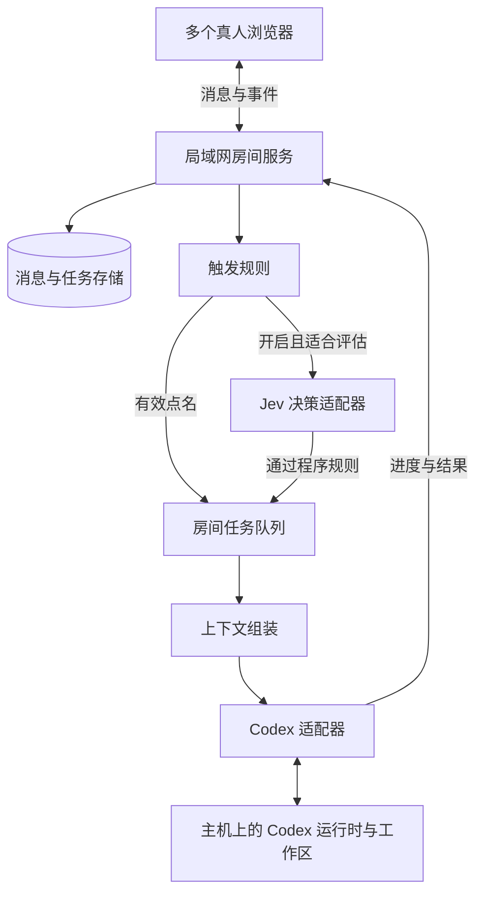

# GroupTalk 多人协作 Agent 设计讨论稿

版本：0.1　日期：2026 年 11 月 5 日　状态：讨论中

GroupTalk 将一个 Codex 对话延伸为局域网群聊：多人可以持续讨论，共享一个有上下文、能提供信息、能执行任务的中心 Agent。Agent 默认等待点名；开启 Jev 后，可以在合适的时候补充、澄清或协助推进讨论。

初步建议是先验证“多人聊天 → @Codex → 补齐讨论 → 回答或执行 → 群内同步结果”这一闭环，再加入主动参与。主要难点在会话归属、上下文可靠性和多人任务协调；Jev 判断费用预计较低，主 Agent 被唤起的次数与执行深度更影响总成本。

## 1 产品目标与设计边界

### 已明确的需求

- 一位发起人在本机分享已有 Codex 对话，同一局域网中的其他人用浏览器加入。
- 多个真人同时发言，共享一个中心 Agent、项目工作区与任务状态。
- 没有点名时，真人可以自由讨论；关闭 Jev 时不自动调用模型。
- 使用 @Codex 时，将尚未交给 Agent 的讨论补充进上下文，再回答或执行任务。
- Jev 可独立开启、关闭；没有 Jev 账号或密钥，基础功能仍可运行。
- Agent 可以承担信息补充、方案比较、提问澄清、讨论引导和任务实现等角色。

### 首版建议假设

单台主机、一个房间对应一个协作会话、约 3–10 人、以文字为主；主机保存项目与服务凭据，加入者无需安装 Codex。支持桌面与手机浏览器的基础聊天布局。

局域网负责连接参与者；调用云端 Codex 或 Jev 时，相应上下文仍会发送给模型服务。纯离线推理属于后续独立选项。

## 2 一次完整的使用过程

1. 房主选择已有对话，预览要分享的历史和工作区，生成局域网邀请链接。
2. 小王和小李加入，设置昵称，讨论“搜索结果是否需要缓存”。所有人实时看到消息，Agent 保持静默。
3. 小李发送“@Codex 结合刚才的讨论，比较两种缓存方案，先不要修改代码”。
4. 系统把上次上下文接收位置之后的消息按顺序整理，保留发言人、消息编号和引用关系，与本次请求一起交给 Agent。
5. Agent 的进度和答复同步给整个房间；真人可以继续讨论。期间的新消息留待下一次触发。
6. 有执行权限的成员发送“@Codex 按方案 B 实现并运行相关检查”。Agent 在主机的指定工作区执行，群内展示任务状态、变更和验证结果。
7. 开启 Jev 后，Agent 可以在讨论出现关键遗漏时主动补充一句。自动参与默认只做讨论辅助；执行仍遵循房间权限和明确任务授权。

这里的核心体验是：多人共同形成问题和决策，Agent 在适当时机参与，并把讨论推进为可检查的结果。

## 3 两种参与模式

| 场景 | Jev 关闭 | Jev 开启 |
| --- | --- | --- |
| 普通真人消息 | 保存并广播，等待点名 | 保存并广播，按节奏评估是否需要参与 |
| 有效 @Codex | 直接进入 Agent 调度 | 同样直接进入调度，不经过 Jev 否决 |
| 自动参与 | 无 | 可补充信息、澄清问题、提示待决事项 |
| Jev 超时或不可用 | 无影响 | 降级为只响应点名，保留群聊和执行能力 |
| Agent 正在执行 | 聊天继续，新的调用排队 | 同左，暂停主动插话评估 |
| 关闭开关 | 不再发起 Jev 请求 | 取消尚未执行的自动唤起，并丢弃在途裁决结果 |

点名建议由输入框生成结构化 mention，粘贴的引用、代码里的 `@Codex` 和 Agent 自己的消息不构成触发。文本别名可以作为兼容入口，但应统一解析，避免意外唤起。

开关属于房间配置，由房主操作，并向成员显示当前模式。关闭后已经交给主 Agent 的回合继续运行，需要停止时使用单独的停止按钮。

## 4 Jev 的定位与接入方式

已核实用户所指模型为 TypeSafe AI 的 **Jev**。它针对给定状态返回类型化决策，核心原语包括 Choice、Score 和 Noul；Noul 返回的是 0–1 之间的判断概率，可以由程序转为布尔结果。[Jev 介绍](https://docs.typesafe.ai/introduction)、[Noul 文档](https://docs.typesafe.ai/primitives/noul)

本项目中，Jev 只判断“现在是否需要 Agent 参与、适合哪种参与”，最终文字和任务执行由 Codex 负责。它不会替群体宣布达成共识，也不会赋予任何人执行权限。

### 建议先拆成原子判断

- 当前讨论是否存在尚未解决、适合 Agent 补充的信息问题？
- 是否有需要先澄清的关键歧义？
- 当前是否适合提醒尚未形成结论的决策点？

程序结合这些结果、房间模式、冷却时间和任务状态，决定保持静默或唤起 Agent。避免把复杂的主持策略全部塞进一个“该不该说话”的问题。

Noul 没有独立的 `confidence` 字段；Choice 和 Score 才有。项目应记录原始概率和实际效果，按本群聊场景调阈值。[置信度说明](https://docs.typesafe.ai/confidence)

### 建议的首轮参数

| 参数 | 初始提案 | 目的 |
| --- | --- | --- |
| 默认模式 | 关闭 | 先保证点名交互可预测 |
| 判断节奏 | 消息安静约 2 秒后合并判断；持续聊天最多每 10 秒评估一次 | 减少逐句请求 |
| 自动发言间隔 | 至少 60 秒 | 避免反复插话 |
| 判断输入 | 最近讨论窗口、主题、最近 Agent 贡献、任务状态 | 控制长度，避免重复建议 |
| 自动触发阈值 | 可先试 0.9，再用标注样本调整 | 优先减少打扰；数值不是已验证结论 |
| 异常行为 | 保持静默，退回点名模式 | 不影响基础功能 |

每次裁决绑定消息位置与配置版本；结果返回时重新检查是否仍然有效。用户已经点名、主题已变化或开关已关闭时，丢弃旧裁决，避免重复回复。

当前官方模型文档列出 `jev-1.14.0`，默认上下文限制为每请求 64k、每问题 32k Token，并提示中文等语言需要用自身数据验证。建议固定版本，评估后再升级；首版采用短文本窗口。[模型与限制](https://docs.typesafe.ai/models)

## 5 系统结构

建议采用浏览器客户端、本机 Node.js 服务、WebSocket 事件通道与 SQLite 持久化。以上为实现提案，依赖版本在原型阶段再确定。

房间服务是唯一 Agent 调度入口。浏览器只提交消息、任务和被授权的控制操作，不持有主机模型凭据，也不直接操作 Codex 进程。

“一个中心 Agent”指共享会话、工作区和调度权。首版不要求多个 Agent 分工，也不为每个成员创建独立 Agent。

## 6 从已有 Codex 对话接入

官方 App Server 提供读取与恢复线程、创建分支、启动和中断回合、接收事件、处理审批等接口，可作为底层接入路径。文档包含 `thread/fork`、`thread/resume`、`turn/start` 等协议能力。[Codex App Server](https://learn.chatgpt.com/docs/app-server)

### 两种会话归属方案

| 方案 | 用户得到什么 | 需要解决什么 |
| --- | --- | --- |
| 原对话交接给房间服务 | 沿用同一底层线程 | 验证桌面端与服务的写入所有权、交接与恢复流程 |
| 从原对话创建协作分支 | 保留已有上下文，群聊继续在分支运行 | 明确显示来源与分支，提供结束后继续工作的入口 |

建议第一版优先验证协作分支。它有明确的运行归属；网页产生的对话和结果保存在协作分支，不能承诺自动回写原桌面对话。

如果“原桌面对话实时同步且仍能同时输入”属于核心要求，应提前作为原型验证项。App Server 提供线程接口，不等于已经具备多人桌面协作产品。

还需要区分**聊天历史可见范围**和**Agent 已继承的上下文**。若协作分支保留了原会话的私密信息，仅隐藏网页历史不能阻止 Agent 引用它。需要限制披露时，应建立经过筛选的新上下文，并检查附件、工具输出和工作区访问范围。

已有 Codex Share 的局域网界面和转发机制可作为后续复用调研对象；本设计不假定它已经支持所有成员并发发言、群聊触发和 Jev。复用收益需根据实际源码与许可评估。

## 7 上下文如何补齐

群聊记录是完整事实来源；Codex 线程保存已提交的上下文和执行记录。普通消息先进入群聊存储，在触发时再批量提交给主 Agent。

### 提交过程

1. 服务端为消息分配房间内递增的 `seq`，以服务端顺序处理并发。
2. 轮到某个调用时，冻结本回合的讨论快照，记录截止位置。
3. 组装尚未提交的消息、引用、发言人、时间和当前调用请求，明确区分讨论材料与本次任务。
4. 记录待提交批次，调用 Codex，并持久化批次与 Codex 回合 ID 的关联。
5. 确认运行时已经接收后，推进上下文提交位置；任务完成情况另行记录。

必须区分“消息已被接收”和“任务已成功完成”。任务失败时，消息可能已经进入线程，直接重发整批会造成重复。提交响应丢失时，先对账线程记录；无法确认则标记待恢复，不自动重跑有副作用的任务。

### 排队时的语义

每个请求保留发起人、引用消息和任务内容。等待期间出现的新讨论，在任务真正开始前作为“后续讨论”补充；它不自动改变原请求的执行目标。有冲突时先展示冲突并澄清。

Agent 运行期间的新消息进入下一批。成员可显式选择“补充给当前任务”或“停止任务”；首版可以先只做排队与停止，后续再支持运行中补充。

### 长讨论

正常情况下完整提交所有未提交消息。超过上下文预算时，分段生成可追溯摘要，保留原消息、关键决定、反对意见、撤销内容与待办，并让成员知道本次使用了摘要。

“完整补齐”指信息可追溯且不静默丢弃；无限长度逐字进入单次模型窗口无法保证。摘要属于有损压缩，其调用费用也应计入。

## 8 多人任务与权限

同一房间先只运行一个主 Agent 回合，其他调用进入可见队列。成员可以看到谁发起、任务目标、上下文截止位置、运行状态和结果。

| 角色提案 | 能力 |
| --- | --- |
| 房主 | 配置分享、历史范围、Jev 开关、成员权限、工作区和执行策略 |
| 讨论成员 | 发言、点名提问、查看共享结果 |
| 执行成员 | 在授权范围内请求修改文件与运行任务 |
| 观察者 | 查看已开放的历史和结果 |

昵称用于展示，服务端成员身份与权限用于授权。首版是否允许所有成员执行，可以由房主在建房时选择。

`@Codex` 表示发起调用；是否可以执行由成员权限、明确请求和运行时策略共同决定。讨论中的“也许可以删掉这个模块”只作为讨论材料。

Jev 自动参与默认只生成讨论回复。群体讨论形成了实现意向时，Agent 可以提出具体任务建议，由有权限的人发起。文件修改、命令执行与外部操作采用主机配置的授权范围；需要审批时，将具体操作交给有权限的成员处理。

多人意见矛盾时保留不同意见，不把最后一句或沉默自动视为共识。执行目标改变时应更新任务，保留谁提出了变更及其依据。

## 9 最小可用版本与后续能力

| 阶段 | 内容 | 完成判断 |
| --- | --- | --- |
| P0 接入验证 | 已有线程读取、协作分支、连续两轮调用、事件与中断 | 能稳定延续上下文，确认运行归属 |
| P1 基础群聊 | 邀请加入、成员身份、并发发言、持久化、点名、上下文补齐、串行任务、重连 | 关闭 Jev 也能完成多人协作任务 |
| P2 Jev 参与 | 开关、批量判断、冷却、降级、裁决记录与费用 | 自动参与有帮助，可随时退回点名模式 |
| P3 讨论辅助 | 决策与待办面板、可配置角色、引用与话题、执行结果回顾 | 群体可以追踪分歧、决策和实现结果 |

首版暂缓语音转写、视频会议、跨公网服务、企业组织接入、多工作区并行任务和多 Agent 编排。资料查询、方案分析、任务实现优先通过主 Agent 已有工具完成。

## 10 费用估算

### Jev 判断费用

截至 2026 年 11 月 5 日，官方价格为每百万输入 Token **0.042 美元**，输出免费。输入仍然需要付费；低费用来自较低输入单价与类型化决策方式。[官方价格](https://help.typesafe.ai/articles/5187202169-how-much-does-jev-cost)

以下是规划假设，均非实测。每房间每天 200 条真人消息；每次判断的完整输入平均 1,200 Token，包含窗口、问题和规则。

| 判断策略 | 判断次数 | 总输入 Token | 每房间每天 Jev 费用 |
| --- | --- | --- | --- |
| 关闭 | 0 | 0 | $0 |
| 合并后评估 | 40 | 48,000 | $0.002016 |
| 每条消息评估 | 200 | 240,000 | $0.01008 |

计算公式为 `判断总输入 Token ÷ 1,000,000 × 0.042`。窗口变长会线性增加输入费用；合并评估也能减少网络请求与重复判断。

### 主 Agent 费用

主 Agent 成本包含历史上下文、补充讨论、工具输出、推理与最终回答。一次任务可能调用模型多次，因此不能只按最终回答长度估算。使用 API 时，还要区分普通输入、缓存读取、适用的缓存写入、输出及工具费用。[OpenAI API 价格](https://developers.openai.com/api/docs/pricing)

举例采用**假设单价**，不指定模型、不作为实际报价：每百万输入 $2、每百万输出 $10。若一天 10 次调用，每次整个回合累计计费输入 20,000、输出 2,000 Token，且忽略缓存和额外工具费用，则约为 **$0.60／房间／天**。

同一假设下，每多触发一次回合约增加 $0.06。相比 40 次 Jev 判断合计约 $0.002，减少无价值的主 Agent 唤起更有意义。

如果接入已有 Codex 登录身份，应以所用账户和运行方式的实际额度、用量与限制为准，不把订阅费用换算为上述 API 账单。Jev 为独立服务，单独计费。

### 主机与开发成本

本机运行可利用现有电脑，仍需承担主机在线、电量、网络和维护成本。房间服务优先不引入额外云服务器。

在一位熟悉 Web 实时通信和 Codex 接入的开发者、文字群聊、单机试用的前提下，初步工作量提案为：

| 工作 | 估计人日 |
| --- | --- |
| P0 接入验证 | 1–2 |
| P1 群聊与任务闭环 | 4–7 |
| P2 Jev 与初步评估 | 2–4 |
| 小范围试用、异常恢复与修正 | 2–4 |
| 合计 | 9–17 |

这是设计阶段估计，P0 后应重新估算。若按假设的综合成本 ¥2,000／人日计算，对应约 ¥18,000–34,000；该数值用于讨论投入规模，不是报价。强制原桌面实时同步、复杂权限或语音会明显扩大范围。

## 11 试用需要验证什么

### 基础功能验收

- 三个客户端同时发言，获得一致顺序；断线重连后补齐缺失消息，重复发送不会重复入库。
- 未配置 Jev 密钥时可以正常启动。关闭 Jev 后，普通消息不触发任何模型调用，有效点名恰好生成一个任务。
- 一次调用能使用此前未提交的多位成员消息，并区分讨论与当前任务。
- Agent 忙碌时继续聊天和排队，重复点击不创建重复执行；失败或重启后能显示可恢复状态。
- 无执行权限的人不能通过点名、昵称或历史引用取得执行权限。
- 成员能看到结果、变更与检查证据；房主撤销分享后旧邀请不能继续加入。

### Jev 效果验收

先收集约 100–200 段中文讨论，覆盖闲聊、信息缺口、争议、引用点名、明确拒绝插话、正在执行和主题切换。人工标注“应否参与”及适当时机，分别观察有帮助的参与率、打扰率、遗漏率、端到端延迟与实际 Token 用量。

建议先以影子模式运行：只记录裁决，不自动发言。确认效果后再开放自动参与。阈值与延迟目标根据局域网真实网络和样本确定，不直接采用宣传数字。

费用面板分别展示 Jev 与主 Agent 用量；自动参与达到房间预算后暂停，点名请求显示剩余预算与队列状态。单次任务内的精确费用上限依赖运行时能力，原型阶段验证。

## 12 首轮需要一起决定的问题

| 决策 | 当前建议 | 对实现和成本的影响 |
| --- | --- | --- |
| 是否必须回到原桌面对话实时同步 | 先采用协作分支，保留继续工作的入口 | 决定接入难度和写入所有权 |
| Jev 能主动做什么 | 先只允许补充、澄清、推进讨论 | 决定打扰风险与主 Agent 调用量 |
| 谁能发起执行任务 | 讨论与执行权限可分配，由房主选择 | 决定加入体验与授权设计 |
| 分享多少原历史 | 建房时预览并明确确认范围 | 决定上下文继承与可见性设计 |
| 是否第一版支持长期房间 | 支持基本持久化、重连和主机恢复 | 决定存储与恢复工作量 |
| 如何判断值得继续做 | 用一次真实的 3–5 人讨论完成需求澄清与一个小功能 | 验证实际协作收益 |

建议第一轮先讨论前三项。它们确定之后，可以把 P0 和 P1 拆为具体原型任务，并用真实试用数据调整 Jev 策略与成本估计。

## 13 方案评审入口

房主和成员进入房间先看到「评审总览」。总览从共享对话和共同记录提取会话总结，展示已发布的核心信息，以及共享对话中索引到的图文材料。成员可以预览或下载材料，点击摘要来源核对原文，再进入群聊发表意见。来源对话提供开房前的共享原文。群聊期间，核心信息也会在右侧协作记录中同步显示。

## 14 外部 Agent 评审

采用由评审方访问房主服务的流程。DeepSeek Harness 的社区插件采用中心节点和历史消息支持 Agent 交流。Harness Sharp 还提供 A2A 的客户端和服务端。GroupTalk 借鉴中心节点负责上下文和消息的组织，首版使用自己的评审链接和内置 Skill 客户端。 [Harness 实时协作插件](https://github.com/dpskh/dsh-a2a) · [Harness Sharp](https://github.com/deepseek-ai/deepseek-harness/discussions/8952)

1. **房主发布评审文本**。服务用现有总结和核心信息预填草稿，房主检查、删改并确认后，固化这一份文本。专用链接绑定首次连接的 IP，有 30 分钟有效期、三条意见配额和手动撤销入口。跨设备用受信任的 HTTPS。已经传给对方的内容可能被保存。
2. **评审方读取和发表意见**。拿到链接的 Agent 通过 Skill 读取授权文本，可以将审核意见发回群聊。服务从 socket 提取 IP，将浏览器和 Agent 的发言归到同一个成员。用户名写入房间存储，房主可修改。普通成员凭证和评审凭证各自保留自己的权限，房主审批继续校验本机房主凭证。
3. **后续接标准 A2A**。协议适配层可以公布 Agent Card，用 Send Message 提交问题、Get Task 查询受限评审。双向追问应使用独立的 Codex 评审会话与相同的已批准文本，新增材料和扩大范围由房主再次确认。群聊中的实际执行继续走 Ask for approval。 [A2A 协议规范](https://a2a-protocol.org/latest/specification/)

首轮验收覆盖链接与普通成员凭证隔离、按 IP 归名、备注持久化、意见去重、撤销和跨设备传输。读取评审文本和提交意见无需房主 Codex 调用。接入双方自动追问后再给每轮明确的额度和终止条件。
